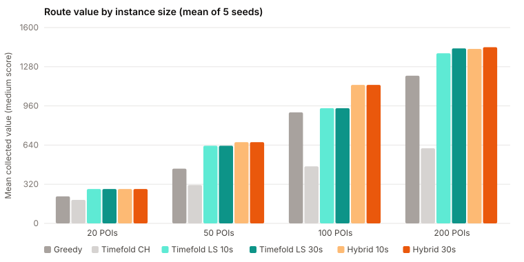
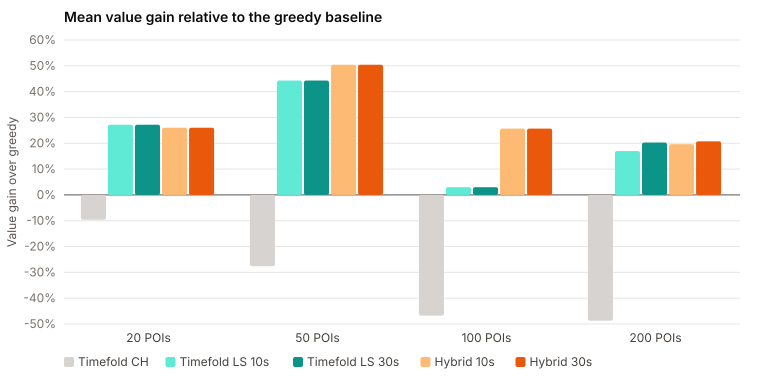
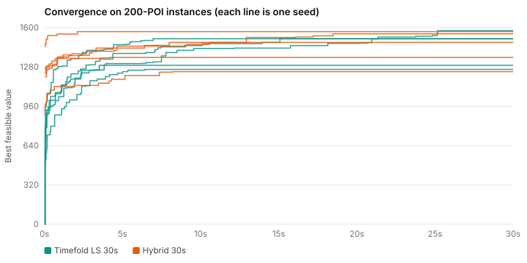
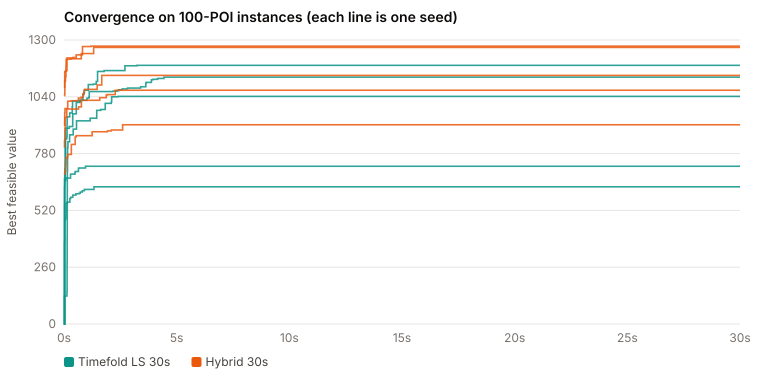

# Planner evaluation — generated results

Generated by `node docs/evaluation/build-report.mjs` from `api/target/experiments`.
Instances: synthetic, 20 / 50 / 100 / 200 POIs, 5 seeds each, July trip, Balanced pace,
3–7 days, budget 15 000 KGS per day.

## Summary table

| POIs | Algorithm | Value (mean ± sd) | Gain vs greedy | Visited | Driving, min | Feasible | Time |
|---:|---|---:|---:|---:|---:|---:|---:|
| 20 | Greedy | 221 ± 75 | — | 4.6 | 895 | 5/5 | 2 ms |
| 20 | Timefold CH | 192 ± 68 | -9.6% | 4.8 | 847 | 5/5 | 24 ms |
| 20 | Timefold LS 10s | 281 ± 92 | +27.2% | 5.4 | 941 | 5/5 | 10.0 s |
| 20 | Timefold LS 30s | 281 ± 92 | +27.2% | 5.4 | 941 | 5/5 | 30.0 s |
| 20 | Hybrid 10s | 281 ± 97 | +26.0% | 5.6 | 991 | 5/5 | 10.0 s |
| 20 | Hybrid 30s | 281 ± 97 | +26.0% | 5.6 | 991 | 5/5 | 30.0 s |
| 50 | Greedy | 447 ± 49 | — | 9.2 | 1356 | 5/5 | 2 ms |
| 50 | Timefold CH | 314 ± 120 | -27.6% | 8.4 | 1195 | 5/5 | 20 ms |
| 50 | Timefold LS 10s | 634 ± 123 | +44.3% | 11.6 | 1498 | 5/5 | 10.0 s |
| 50 | Timefold LS 30s | 634 ± 123 | +44.3% | 11.6 | 1498 | 5/5 | 30.0 s |
| 50 | Hybrid 10s | 664 ± 93 | +50.4% | 11.6 | 1398 | 5/5 | 10.0 s |
| 50 | Hybrid 30s | 664 ± 93 | +50.4% | 11.6 | 1398 | 5/5 | 30.0 s |
| 100 | Greedy | 907 ± 148 | — | 15.8 | 2130 | 5/5 | 4 ms |
| 100 | Timefold CH | 466 ± 196 | -46.8% | 13.4 | 1679 | 5/5 | 24 ms |
| 100 | Timefold LS 10s | 941 ± 224 | +3.0% | 20.0 | 1749 | 5/5 | 10.0 s |
| 100 | Timefold LS 30s | 941 ± 224 | +3.0% | 20.0 | 1749 | 5/5 | 30.0 s |
| 100 | Hybrid 10s | 1132 ± 134 | +25.7% | 18.4 | 2080 | 5/5 | 10.0 s |
| 100 | Hybrid 30s | 1132 ± 134 | +25.7% | 18.4 | 2080 | 5/5 | 30.0 s |
| 200 | Greedy | 1207 ± 179 | — | 17.6 | 1844 | 5/5 | 13 ms |
| 200 | Timefold CH | 614 ± 100 | -48.7% | 17.4 | 1935 | 5/5 | 56 ms |
| 200 | Timefold LS 10s | 1390 ± 98 | +17.0% | 21.0 | 1672 | 5/5 | 10.0 s |
| 200 | Timefold LS 30s | 1430 ± 128 | +20.3% | 21.0 | 1781 | 5/5 | 30.0 s |
| 200 | Hybrid 10s | 1426 ± 114 | +19.6% | 20.0 | 1782 | 5/5 | 10.0 s |
| 200 | Hybrid 30s | 1440 ± 123 | +20.8% | 20.0 | 1826 | 5/5 | 30.0 s |

## How often the optimiser beats the baseline

| POIs | Timefold LS 30s beats greedy | Hybrid 30s beats greedy |
|---:|---:|---:|
| 20 | 5/5 | 5/5 |
| 50 | 5/5 | 5/5 |
| 100 | 2/5 | 5/5 |
| 200 | 5/5 | 5/5 |

## Time to the best solution

| POIs | Algorithm | Mean time to best | Max time to best |
|---:|---|---:|---:|
| 20 | Timefold LS 30s | 0.1 s | 0.2 s |
| 20 | Hybrid 30s | 0.0 s | 0.1 s |
| 50 | Timefold LS 30s | 0.4 s | 1.0 s |
| 50 | Hybrid 30s | 0.2 s | 0.5 s |
| 100 | Timefold LS 30s | 2.5 s | 4.4 s |
| 100 | Hybrid 30s | 2.2 s | 3.8 s |
| 200 | Timefold LS 30s | 11.8 s | 25.2 s |
| 200 | Hybrid 30s | 8.2 s | 18.5 s |

## Charts

